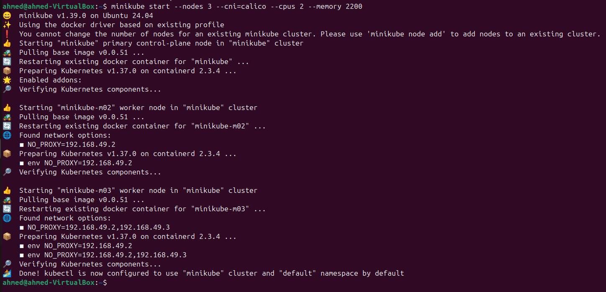
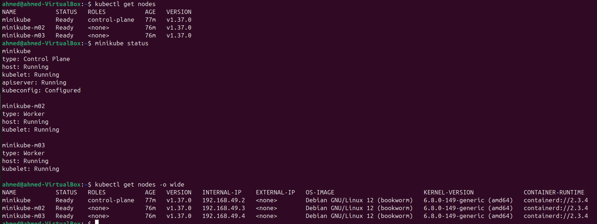
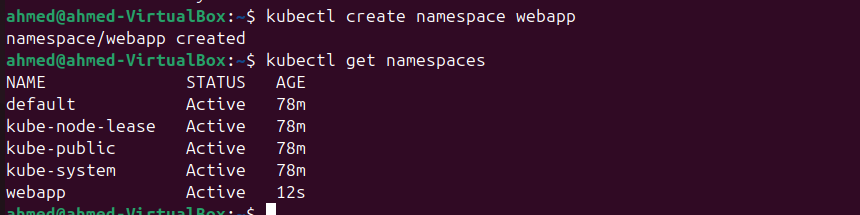
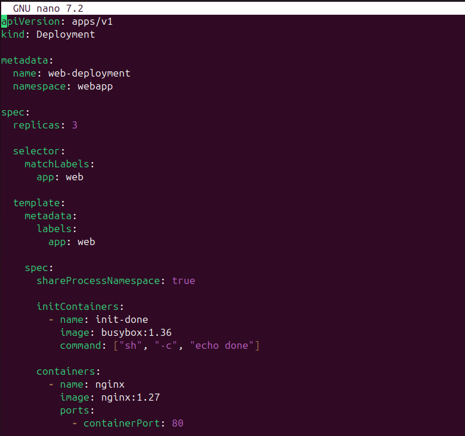
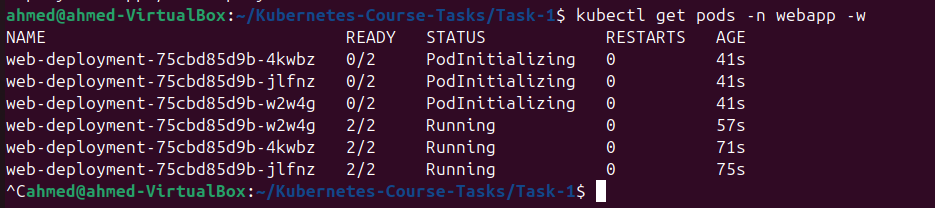
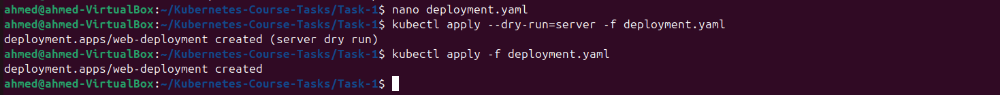
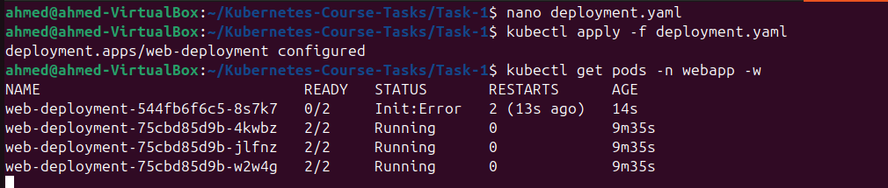
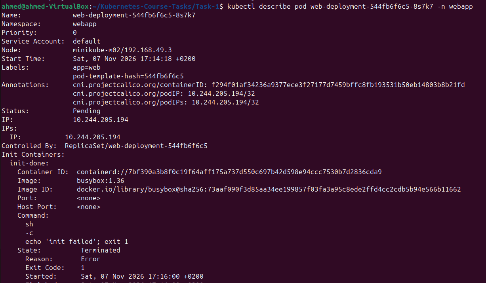
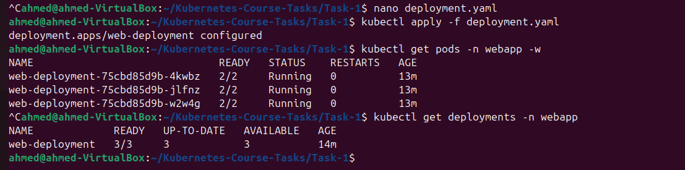

# Task 1: Multi-Container Pods (Init Container & Sidecar)

## 1. Introduction

In this task, I created a multi-node Kubernetes cluster using Minikube and deployed a multi-container application using Nginx.

The application displays a welcome message with the current date and time. A sidecar container updates the HTML page automatically every 5 seconds without using Kubernetes volumes.

The task also demonstrates how Kubernetes handles Init Container failures and how the Deployment recovers after fixing the error.

## 2. Environment Setup

The task was implemented using the following environment:

| Component | Version |
|---|---|
| Operating System | Ubuntu 24.04.2 LTS |
| Docker | 29.9.3 |
| kubectl | v1.37.2 |
| Minikube | v1.39.0 |
| Kubernetes | v1.37.0 |
| CNI Plugin | Calico |
| Minikube Driver | Docker |

### 2.1 Install and Verify Docker

Docker Engine was installed and configured as the container driver for Minikube.

I verified the installation using:

```bash
docker --version
docker run hello-world
```

**Screenshot: Docker installation and verification**


### 2.2 Install kubectl and Minikube

I installed kubectl to manage Kubernetes resources and Minikube to create a local Kubernetes cluster.

The installations were verified using:

```bash
kubectl version --client
minikube version
minikube config view
```

The Docker driver was configured as the default Minikube driver.

## 3. Create the Kubernetes Cluster

I created a three-node Kubernetes cluster with one Control Plane node and two Worker nodes.

The Calico CNI plugin was configured during cluster creation.

Command:

```bash
minikube start --nodes 3 --cni=calico --cpus 2 --memory 2200
```

After the cluster started successfully, I checked the nodes:

```bash
kubectl get nodes -o wide
```

All three nodes reached the `Ready` state.

**Screenshot: Kubernetes Cluster Nodes**



**Screenshot: Minikube Status**



## 4. Create the Namespace

I created a dedicated namespace named `webapp` to organize the application resources.

Command:

```bash
kubectl create namespace webapp
```

I verified that the namespace was created successfully:

```bash
kubectl get namespaces
```

**Screenshot: Namespace Creation**



## 5. Create the Multi-Container Deployment

I created a Kubernetes Deployment named `web-deployment` inside the `webapp` namespace.

The Deployment uses three replicas, and each Pod contains three containers:

| Container | Type | Responsibility |
|---|---|---|
| init-done | Init Container | Prints `done` and exits successfully. |
| nginx | Main Container | Generates the HTML page and runs the Nginx server. |
| time-updater | Sidecar | Updates the HTML page every 5 seconds. |

### 5.1 Important Configuration

**Three replicas:**

```yaml
replicas: 3
```

**Shared process namespace:**

```yaml
shareProcessNamespace: true
```

This allows the sidecar to see processes running in the Nginx container.

**No volumes:**

The task was implemented without using Kubernetes volumes.

**Sidecar capability:**

```yaml
securityContext:
  capabilities:
    add:
      - SYS_PTRACE
```

### 5.2 Deployment Manifest

The complete Kubernetes configuration is available in:

[`deployment.yaml`](deployment.yaml)

Before deploying the application, I validated the manifest:

```bash
kubectl apply --dry-run=server -f deployment.yaml
```

Then I created the Deployment:

```bash
kubectl apply -f deployment.yaml
```

**Screenshot: Deployment Manifest Validation**



## 6. Deploy and Verify the Application

I monitored the Pods until all containers were running:

```bash
kubectl get pods -n webapp -w
```

All three Pods reached `2/2 Running`.

The Init Container is not counted in the READY status after successful completion. Therefore, each Pod shows two ready containers: Nginx and time-updater.

**Screenshot: All Pods Running**



I also verified the Deployment:

```bash
kubectl get deployments -n webapp
```

The Deployment reached `3/3 Ready`.

**Screenshot: Deployment Status**



### 6.1 Verify Pod Distribution

I checked the nodes assigned to each Pod:

```bash
kubectl get pods -n webapp -o wide
```

The three Pods were distributed across the three cluster nodes.

**Screenshot: Pod Distribution**


### 6.2 Verify Container Names

I checked the Init Container and regular container names:

```bash
kubectl get pods -n webapp -l app=web \
-o jsonpath='{.items[0].spec.initContainers[*].name}{"\n"}{.items[0].spec.containers[*].name}{"\n"}'
```

The output confirmed:

```text
init-done
nginx time-updater
```

### 6.3 Verify Init Container

I checked the Init Container logs:

```bash
kubectl logs deploy/web-deployment -n webapp -c init-done
```

Expected output:

```text
done
```

**Screenshot: Init Container Logs**


## 7. Verify Sidecar Functionality

To verify that the sidecar could access the Nginx process, I executed:

```bash
kubectl exec deploy/web-deployment -n webapp -c time-updater -- ps
```

The output showed the Nginx process, confirming that the shared process namespace was working.

**Screenshot: Sidecar Process Visibility**


### 7.1 Verify Automatic Time Updates

The sidecar searches for the Nginx process and updates the HTML file through its process root filesystem:

```bash
PID=$(pgrep -o nginx)

echo "<h1>hello in MLOPS MENA COMMUNITY : $(date '+%Y-%m-%d %H:%M:%S')</h1>" \
> /proc/$PID/root/usr/share/nginx/html/index.html
```

I verified the HTML file from the Nginx container:

```bash
kubectl exec deploy/web-deployment -n webapp -c nginx -- \
cat /usr/share/nginx/html/index.html
```

After waiting 5 seconds, I executed the command again and confirmed that the timestamp had changed.

**Screenshot: Automatic Time Updates**


## 8. Access the Nginx Web Application

I exposed the Deployment locally using port forwarding:

```bash
kubectl port-forward -n webapp deploy/web-deployment 8080:80
```

Then I accessed the application through:

```text
http://localhost:8080
```

The web page displayed the welcome message and current timestamp.

Refreshing the page after 5 seconds showed the updated time.

**Screenshot: Nginx Web Application**


## 9. Test Init Container Failure

To understand how Kubernetes handles Init Container failures, I modified the Init Container command.

Original command:

```yaml
command: ["sh", "-c", "echo done"]
```

Modified command:

```yaml
command: ["sh", "-c", "echo 'init failed'; exit 1"]
```

I applied the modified configuration:

```bash
kubectl apply -f deployment.yaml
```

Then I monitored the Pods:

```bash
kubectl get pods -n webapp -w
```

The newly created Pod entered the `Init:Error` state and eventually `Init:CrashLoopBackOff`.

The Nginx and time-updater containers did not start because the Init Container failed.

The previously running Pods remained available during the failed rolling update.

**Screenshot: Init Container Failure**



### 9.1 Inspect the Failure

I checked the Init Container logs:

```bash
kubectl logs <new-pod> -n webapp -c init-done
```

Output:

```text
init failed
```

**Screenshot: Init Failure Logs**


I also inspected the Pod details:

```bash
kubectl describe pod <new-pod> -n webapp
```

The output showed:

```text
Exit Code: 1
```

This confirmed that the Init Container terminated unsuccessfully.

**Screenshot: Pod Failure Details**



### 9.2 Answers to the Task Questions

**Q1: Which status does the new Pod show?**

The new Pod shows `Init:Error`, followed by `Init:CrashLoopBackOff`.

**Q2: Do Nginx and time-updater start?**

No. Kubernetes does not start the regular containers until all Init Containers complete successfully.

**Q3: Is the page still reachable, and why?**

Yes. The old Pods remain running during the failed rolling update, so the application remains available through the existing replicas.

## 10. Fix the Init Container

To restore the application, I changed the Init Container command back to:

```yaml
command: ["sh", "-c", "echo done"]
```

Then I applied the corrected manifest:

```bash
kubectl apply -f deployment.yaml
```

I monitored the Pods until the Deployment recovered.

```bash
kubectl get pods -n webapp -w
kubectl get deployments -n webapp
```

All three replicas returned to the `2/2 Running` state, and the Deployment reached `3/3 Ready`.

**Screenshot: Successful Deployment Recovery**



## 11. Final Results

The task was completed successfully.

| Requirement | Result |
|---|---|
| Three-node Minikube cluster | Completed |
| Calico CNI | Configured |
| `webapp` namespace | Created |
| Three Deployment replicas | Running |
| Init Container | Verified |
| Nginx main container | Running |
| Sidecar container | Running |
| Shared process namespace | Verified |
| Automatic time updates | Verified |
| No volumes | Confirmed |
| Init Container failure | Tested |
| Deployment recovery | Successful |


**Task:** Session 1 – Multi-Container Pods (Init Container & Sidecar)  
**Community:** MLOPS MENA COMMUNITY
